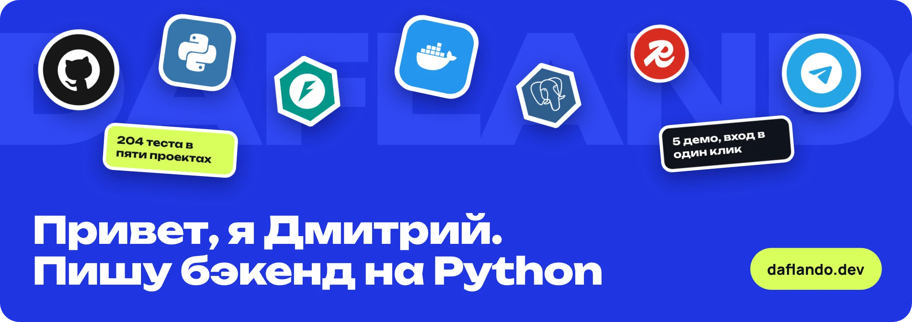
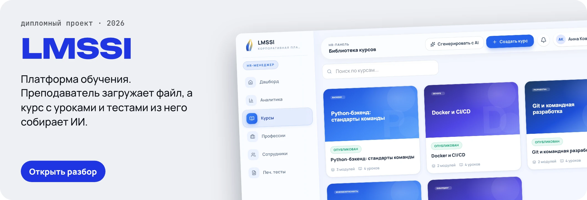
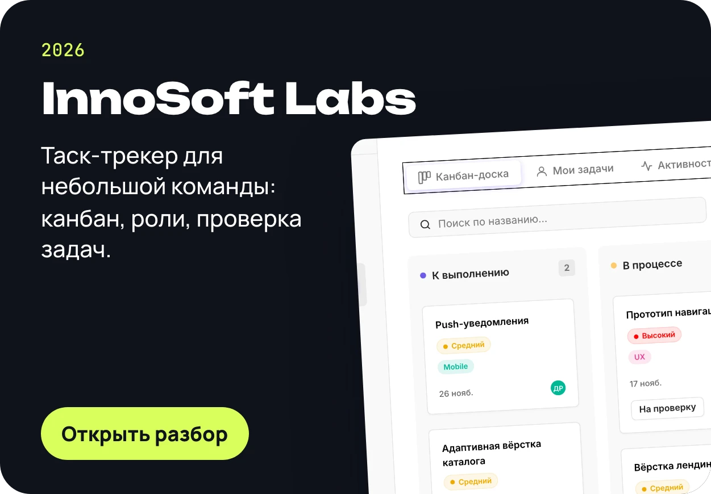
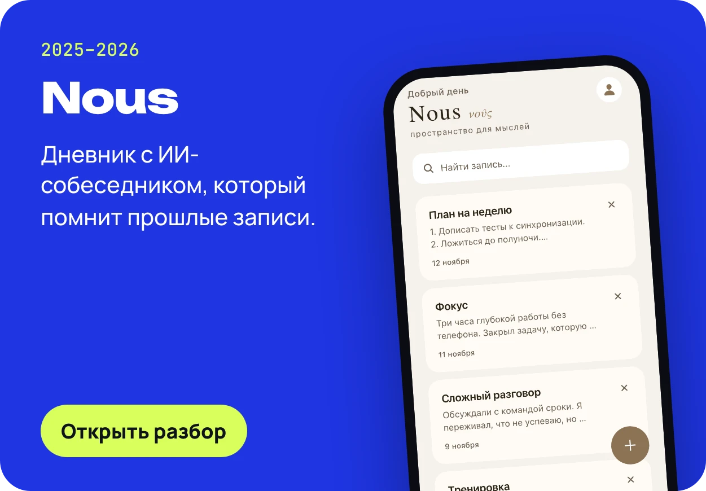

Живу в Минске. Программировать начал в 14 лет: верстал простые сайты на HTML и CSS, потом стал автоматизировать свои задачи, и из этого выросло несколько заказов на ботов и интеграции. Последние четыре года пишу в основном на Python.

Больше всего люблю делать проект целиком, от схемы базы до деплоя на сервер. Ниже пять таких. Все развёрнуты, в любой можно зайти без регистрации и посмотреть, как он работает.

## Проекты

Картинки ведут на разбор каждого проекта: что он умеет и как устроен внутри. А здесь коротко и со ссылками.

**LMSSI.** Мой дипломный проект. Преподаватель загружает Word, PDF или презентацию и получает курс с уроками и тестами, который потом правит в конструкторе. Генерация идёт в фоне, а всё, что вернула модель, проверяет код, прежде чем это попадёт в курс. FastAPI, SQLAlchemy 2, PostgreSQL, React.\
[Демо](https://lms.daflando.dev/demo/hr) · [Разбор](https://daflando.dev/lmssi/)

**InnoSoft Labs.** Таск-трекер: канбан, приглашения по ссылке, файлы, календарь. Задачу нельзя закрыть самому, её принимает менеджер. Права проверяются на сервере по роли в проекте, изменения приходят всем участникам сразу через Socket.IO. FastAPI, MySQL, Redis, MinIO.\
[Демо](https://innosoft.daflando.dev/demo/manager) · [Разбор](https://daflando.dev/innosoft/)

**Ryadom.** Пет-проект. Психолог отвечает на несколько вопросов и за пару минут получает свою страницу: с готовыми текстами, одной из четырёх тем и правкой прямо на странице. Всё рассчитано на телефон. Next.js, TypeScript, Supabase.\
[Демо](https://ryadom.daflando.dev/try) · [Код](https://github.com/DaFlanDo/ryadom) · [Разбор](https://daflando.dev/ryadom/)

**Nous.** Дневник, в котором можно поговорить с ИИ о своих записях. Ассистент сам решает, что ему нужно: найти старую запись, открыть запись за дату или завести список дел. Писать можно без сети, а в базе записи лежат зашифрованными. FastAPI, MongoDB, Expo.\
[Демо](https://nous.daflando.dev/demo) · [Код](https://github.com/DaFlanDo/nous) · [Разбор](https://daflando.dev/nous/)

**GameTrust.** Самый ранний из пяти, писал его на учебной практике в 2025 году. Маркетплейс игровых товаров, где деньги лежат на удержании, пока покупатель не подтвердит получение. В 2026 вернулся к нему: переписал операции с деньгами, добавил тесты, Docker и CI. Flask, PostgreSQL, Redis.\
[Демо](https://gametrust.daflando.dev/demo/buyer) · [Код](https://github.com/DaFlanDo/GameTrust) · [Разбор](https://daflando.dev/gametrust/)

## С чем работаю

Основное: Python, FastAPI, SQLAlchemy, PostgreSQL, Redis и Docker. В проектах выше были ещё Flask, MySQL, MongoDB, Socket.IO и MinIO. Тесты пишу на pytest, разворачиваю на своём VPS через Docker Compose и Caddy. Если проекту нужен фронтенд, делаю его на React и TypeScript.

Telegram: [@daflando](https://t.me/daflando) · сайт: [daflando.dev](https://daflando.dev)
